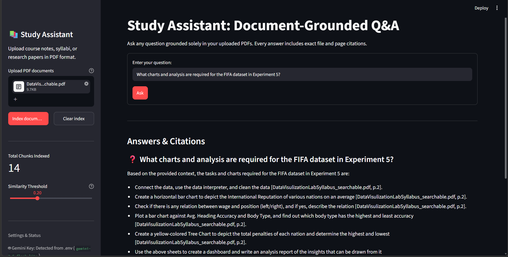
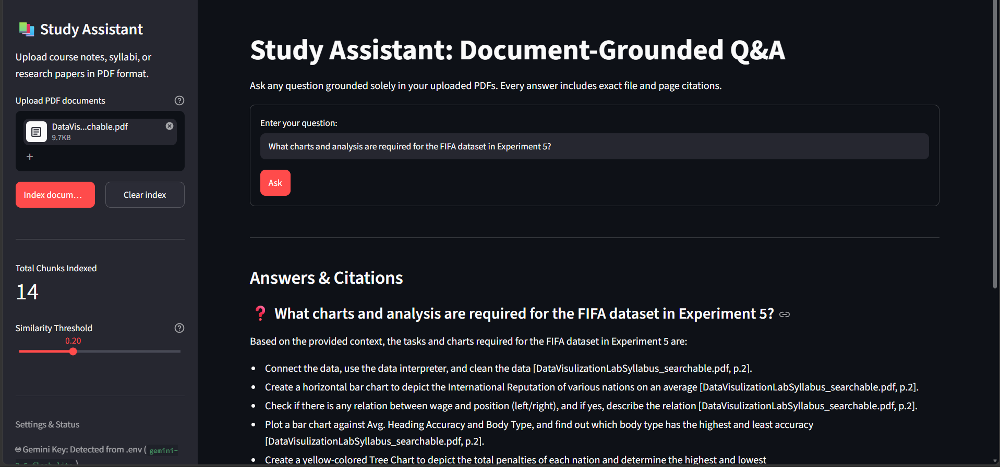
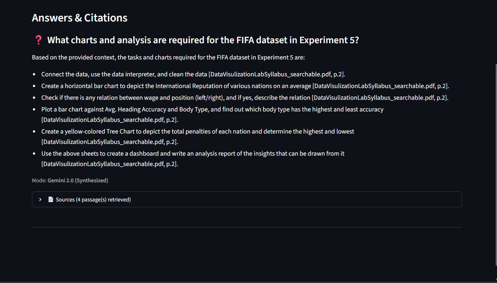
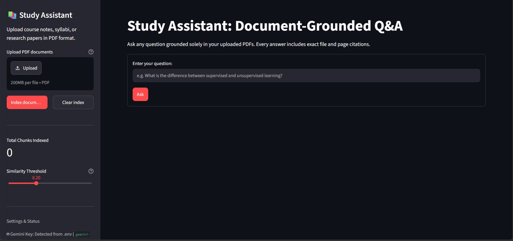

# 📚 Study Assistant: Offline-First Grounded RAG

[](https://yuvi-study-assistant.streamlit.app)
[](https://www.python.org/)

> 🚀 **Live Demo**: [**yuvi-study-assistant.streamlit.app**](https://yuvi-study-assistant.streamlit.app)

An open-source, offline-first Retrieval-Augmented Generation (RAG) study assistant built with Streamlit, SentenceTransformers, and FAISS. Students can upload their course notes, syllabi, and textbooks in PDF format, ask questions, and receive factual answers grounded solely in the uploaded documents—complete with exact file name and page number citations.

---

## 📸 Application Screenshots

Here are some screenshots of the running application:

### 1. Document Q&A & Synthesized Answers


### 2. Grounded Answers with Inline Citations


### 3. Detailed Source Passages & Similarity Scores


### 4. Document Ingestion & Sidebar Management


---

## 🏗 Architecture Overview

```
+---------------------------------------------------------------------------------+
|                                Streamlit UI (app.py)                            |
|    - Multi-PDF Upload & Indexing Trigger                                        |
|    - Q&A Chat Form & Citation Display                                           |
+-----------------------------------------+---------------------------------------+
                                          |
                                          v
+---------------------------------------------------------------------------------+
|                                RAGPipeline (src/pipeline.py)                    |
+-----------------------------------------+---------------------------------------+
        | Ingestion Flow                                          | Query Flow
        v                                                         v
+-----------------------+                         +-------------------------------+
|  PDF Loader (pypdf)   |                         | Embedder (SentenceTransformer)|
|  - Page extraction    |                         | - Encodes user query to L2-   |
|  - Empty page removal |                         |   normalized float32 vector   |
+-----------+-----------+                         +---------------+---------------+
            |                                                     |
            v                                                     v
+-----------------------+                         +-------------------------------+
|  Page-Aware Chunker   |                         |  Retriever                    |
|  - 800-char window    |                         |  - FAISS IndexFlatIP (cosine) |
|  - 150-char overlap   |                         |  - Filter by similarity >=0.25|
|  - Preserves bounds   |                         +---------------+---------------+
+-----------+-----------+                                         |
            |                                                     v
            v                                     +-------------------------------+
+-----------------------+                         |  Generator (src/generator.py) |
| Embedder (MiniLM-L6)  |                         |  - Gemini 2.0 (if key set)    |
| - Class-level cached  |                         |  - Extractive Top-2 Fallback  |
+-----------+-----------+                         |  - Refusal if no context      |
            |                                     +-------------------------------+
            v                                                     |
+-----------------------+                                         v
| VectorStore (FAISS)   |                                 Final Answer & Citations
| - faiss.IndexFlatIP   |                                 e.g., [sample_notes.pdf, p.2]
+-----------------------+
```

---

## ⚙️ Key Features

- **Offline-First & Privacy-Focused**: Runs completely locally on CPU without paid API requirements (only downloads the 80MB embedding model once on initial setup).
- **Page-Boundary Preservation**: Chunks are split using sentence-boundary heuristics without ever crossing page boundaries, ensuring 100% accurate page citations.
- **Dual Synthesis Modes**:
  - **Gemini Mode**: When `GEMINI_API_KEY` is present, answers are synthesized via Google Gemini 2.0 Flash with inline citations.
  - **Extractive Mode (Default Fallback)**: Quotes the top-2 most relevant passages with citations, guaranteeing the app never crashes due to missing keys or network failure.
- **Strict Hallucination Resistance**: Out-of-scope questions below the similarity threshold (`SIMILARITY_THRESHOLD = 0.25`) return a clear refusal: *"I could not find this in the uploaded documents."*
- **Rigorous Evaluation Suite**: Included benchmark script calculating Hit Rate@1, Hit Rate@3, Hit Rate@4, Mean Reciprocal Rank (MRR), and a sentence-level Faithfulness Proxy.

---

## 🚀 Setup Instructions

### Prerequisites
- Python 3.11 installed on your system.

### 1. Clone & Create Virtual Environment
```bash
# Clone the repository
git clone <repo-url>
cd rag-study-assistant

# Create Python 3.11 virtual environment
python -m venv .venv

# Activate the virtual environment
# Windows (PowerShell):
.venv\Scripts\Activate.ps1
# Windows (Command Prompt):
.venv\Scripts\activate.bat
# Linux/macOS:
source .venv/bin/activate
```

### 2. Install Dependencies
```bash
pip install -r requirements.txt
```

---

## 🔑 Optional Gemini API Configuration

To enable synthesized answers with Google Gemini:
1. Copy the example environment file:
   ```bash
   cp .env.example .env
   ```
2. Open `.env` and set your API key:
   ```env
   GEMINI_API_KEY=your_gemini_api_key_here
   GEMINI_MODEL=gemini-2.0-flash
   ```

*Note: If `GEMINI_API_KEY` is left blank or unset, Study Assistant automatically and gracefully operates in offline Extractive Mode.*

---

## 💻 Running the Application

Launch the Streamlit web application:

```bash
streamlit run app.py
```
*(On Windows systems where executable stubs are restricted, run via Python: `python -m streamlit run app.py`)*

### Using the App:
1. Open your browser at `http://localhost:8501`.
2. In the sidebar, upload one or more PDF documents.
3. Click **"Index documents"** and wait for the indexing spinner to complete.
4. In the main input box, type your study question and click **"Ask"**.
5. View the answer, the execution mode caption, and expand the **"Sources"** dropdown to inspect the exact citations and similarity scores.

---

## 🧪 Running Automated Tests

Run the test suite using `pytest`:

```bash
pytest -v
```

The test suite validates:
- **`test_chunker.py`**: Chunks stay within `CHUNK_SIZE + tolerance`, overlap preserves context, and page numbers remain strictly bounded.
- **`test_retriever.py`**: Semantic search successfully retrieves the Databases page (Page 2) in the top 2 for SQL queries.
- **`test_pipeline.py`**: End-to-end ingestion and answering in extractive mode when `GEMINI_API_KEY` is unset, and refusal behavior on unrelated queries (e.g., *"What is the capital of France?"*).

---

## 📊 Evaluation & Benchmark Results

### Generating the Benchmark PDF
```bash
python eval/make_sample_pdf.py
```
This generates `data/sample/sample_notes.pdf`, a 4-page factual computer science document covering:
- **Page 1**: Machine Learning Basics (supervised learning, overfitting, bias-variance tradeoff, gradient descent, k-fold cross-validation)
- **Page 2**: Databases and SQL Architecture (relational model, ACID properties, B-Tree indexes, normalization, joins)
- **Page 3**: Operating System Scheduling (process states, scheduling algorithms, context switching, deadlock Coffman conditions, paging)
- **Page 4**: Computer Networks (OSI 7-layer model, TCP 3-way handshake vs UDP, IP routing, DNS resolution, HTTPS/TLS)

### Running the Evaluation
```bash
python eval/evaluate.py
```

### Benchmark Results
Evaluated on `eval/eval_set.json` (16 test questions across all 4 knowledge domains):

| Metric | Score | Description |
| :--- | :---: | :--- |
| **Hit Rate @ 1** | **100.00%** | Relevant document page retrieved at rank 1 |
| **Hit Rate @ 3** | **100.00%** | Relevant document page present in top 3 results |
| **Hit Rate @ 4** | **100.00%** | Relevant document page present in top 4 results |
| **Mean Reciprocal Rank (MRR)** | **1.0000** | Average reciprocal rank of first relevant chunk |
| **Faithfulness Proxy** | **61.26%** | Fraction of answer sentences with max cosine similarity $\ge 0.5$ to retrieved chunks |

> *Note on Faithfulness Proxy: This is a fast, offline heuristic that measures the percentage of answer sentences having a cosine similarity $\ge 0.5$ to any retrieved source chunk. It serves as an automated semantic grounding indicator, distinct from an LLM-adjudicated ground truth faithfulness evaluation.*

---

## ☁️ Deployment to Streamlit Community Cloud

Deploying Study Assistant to [Streamlit Community Cloud](https://streamlit.io/cloud) is straightforward:

1. **Push Repository to GitHub**:
   Ensure all project files (including `requirements.txt` and `packages.txt` if needed) are committed to a GitHub repository.
2. **Create New App on Streamlit Cloud**:
   - Log in to your Streamlit Community Cloud account.
   - Click **"Create app"** and select your GitHub repository and branch.
   - Set **Main file path** to `app.py`.
3. **Configure Secrets (Optional Gemini Support)**:
   - In the Streamlit Cloud dashboard for your app, go to **Settings** > **Secrets**.
   - Add your Gemini API key:
     ```toml
     GEMINI_API_KEY = "your_actual_gemini_api_key"
     GEMINI_MODEL = "gemini-2.0-flash"
     ```
4. **Deploy**:
   - Click **"Deploy!"**.
   - Streamlit Cloud will install `requirements.txt`, load the PyTorch and SentenceTransformer dependencies, and launch the web app.

---

## 📂 Project Structure

```
Study Assistant/
├── app.py                     # Streamlit web application
├── requirements.txt           # Pinned dependencies for Python 3.11
├── .env.example               # Template environment configuration
├── README.md                  # Comprehensive documentation and setup guide
├── .gitignore                 # Standard Python/IDE ignore rules
├── src/
│   ├── __init__.py
│   ├── config.py              # System constants and model hyperparameters
│   ├── pdf_loader.py          # PyPDF page-by-page loader with error handling
│   ├── chunker.py             # Boundary-preserving sentence-trimmed chunker
│   ├── embedder.py            # SentenceTransformer model wrapper with caching
│   ├── vector_store.py        # FAISS IndexFlatIP cosine vector store
│   ├── retriever.py           # Top-k similarity retrieval with threshold filtering
│   ├── generator.py           # Gemini 2.0 generator with robust extractive fallback
│   └── pipeline.py            # End-to-end RAG orchestrator
├── eval/
│   ├── __init__.py
│   ├── make_sample_pdf.py     # ReportLab script generating 4-page test PDF
│   ├── eval_set.json          # 16 domain-specific evaluation questions
│   ├── evaluate.py            # Evaluation script computing Hit@k, MRR & Faithfulness
│   └── results.json           # Real evaluation run output
├── tests/
│   ├── test_chunker.py        # Unit tests for chunk bounds, overlap, and page IDs
│   ├── test_retriever.py      # Integration test for SQL/Database retrieval
│   └── test_pipeline.py       # Pipeline tests for extractive fallback & refusals
└── data/
    └── sample/
        └── sample_notes.pdf   # 4-page sample PDF artifact
```
